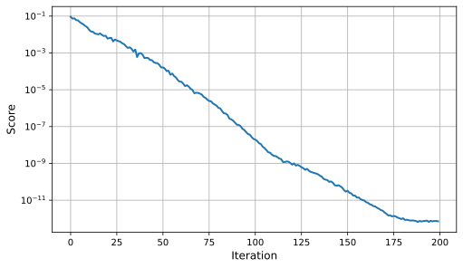

# ANYmal Example: PACE Workflow


This section demonstrates the complete PACE workflow using **ANYmal** as an example platform. While the data collection is typically performed directly on the real robot hardware, we present the full pipeline in simulation to illustrate the process and enable safe testing and validation prior to hardware deployment.

---

## Data Collection

This step generates excitation data required for evolutionary parameter identification. The procedure fixes ANYmal in mid-air and applies a crafted feed-forward joint-space trajectory designed to excite all joints simultaneously.

### Trajectory description

* Duration: **20 seconds**
* Signal type: **Chirp trajectory**
* Frequency range: **0.1 – 10 Hz**
* All joints are excited concurrently

The following physical properties are configured to closely match the estimated parameters of the real ANYmal hardware:

* Joint armature
* Viscous damping
* Static and dynamic friction (dynamic = 0.5 × static)
* Joint bias
* Actuator delay

This setup allows realistic synthetic data generation while avoiding risk to the real system.

### Execution

Inside the virtual environment, run:

```bash
cd ~/pace-sim2real
python scripts/pace/data_collection.py
```


The collected data is saved in:

```
pace-sim2real/data/anymal_d_sim/chirp_data.pt
```

This dataset serves as the input for the PACE optimization pipeline.

---

## Evolutionary Parameter Identification

This step runs the PACE evolutionary optimization to identify actuator and joint parameters that best match the recorded trajectory.

### Configuration

* Number of environments: **4096**
* Total identified parameters: **61**

    * 12 joint armature values
    * 12 viscous friction values
    * 12 static friction values
    * 12 joint bias values
    * 1 global delay
    * 12 dynamic/static friction ratios (`separate_dynamic_friction=True`)

In this example, the optimizer re-estimates the parameters used in the simulation data collection stage, serving as a proof-of-correctness. In real deployments, this step is used to identify parameters of custom hardware platforms.

!!! note "Static and dynamic friction"
    This example identifies static and dynamic friction separately, which adds 12 parameters compared to the original paper (61 instead of 49). The friction parameter is then the static (break-away) friction, and the dynamic friction is identified as a ratio of it in `[0, 1]`, so dynamic friction never exceeds static friction.

    Setting `separate_dynamic_friction = False` in `AnymalDPaceCfg` falls back to standard Coulomb friction (static = dynamic) with 49 parameters, as in the paper. Use the split if break-away friction is significant on your system, or if you do not mind the additional parameters and complexity.

### Execution

Inside the virtual environment, run:

```bash
cd ~/pace-sim2real
python scripts/pace/fit.py --headless
```

The optimization progress can be monitored using TensorBoard in:

```
pace-sim2real/logs/pace/anymal_d_sim
```


### Performance

!!! info
    The numbers and the score plot below were obtained with PACE v0.1.x (49 parameters, torque delay). Runtime and convergence may differ with the default v0.2.0 setup (61 parameters, command delay).

* Convergence: up to numerical precision (**~1e-12**)
* Runtime: approximately **2:15 hours** on an NVIDIA RTX 3080

Empirically, final scores below **0.005** indicate a high-quality fit and typically lead to strong sim-to-real transfer performance (e.g. ANYmal using real data is below 0.003, compare [paper](https://arxiv.org/pdf/2509.06342) Figure 9.).

<picture class="plot-full">
  
</picture>



---

## Testing the Identified Parameters

This step evaluates the optimized parameters by visualizing the best-matching trajectory.

The script:

* Plots the best simulated trajectory
* Compares it with the original collected data
* Prints the evolution of the best parameters across iterations

### Execution

Inside the virtual environment, run:

```bash
cd ~/pace-sim2real
python scripts/pace/plot_trajectory.py --plot_trajectory
```

This provides a final verification step before deploying parameters into a learning or control pipeline.

---

## Deploying on Hardware

To use the identified parameters in your learning environment, integrate the PACE actuator model into your project.

Copy the following files (or directly import them in your learning environment):

* `pace-sim2real/source/pace_sim2real/pace_sim2real/utils/pace_actuator.py`
* `pace-sim2real/source/pace_sim2real/pace_sim2real/utils/pace_actuator_cfg.py`

Use the following procedure:

1. Import `PaceDCMotor` and `PaceDCMotorCfg` into your project.
2. During initialization, set:

    * Joint delay (`max_delay`) and `delay_mode` (the default `"command"` is used in this example)
    * Joint bias

    using the values obtained from the parameter identification step.

3. Prior to training, configure your articulation object with the optimized parameters for:

    * `joint_armature`
    * `joint_viscous_friction`
    * `joint_friction`
    * `joint_dynamic_friction` (static friction × identified ratio)

### Recommended validation step

Before training locomotion policies, we recommend replaying the collected real-world data within your learning environment. This serves as an additional sanity check to ensure the simulation faithfully reproduces the system dynamics prior to policy optimization.
