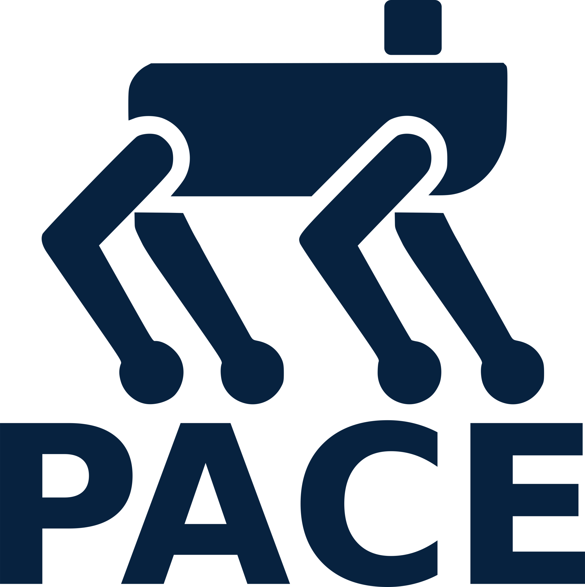

<p align="center">
  
</p>


# PACE Documentation

Welcome to the documentation for **PACE (Precise Adaptation through Continuous Evolution)**, a systematic sim-to-real pipeline for diverse legged robots.

PACE provides unified tools for accurate actuator modeling, automatic system identification for seamless deployment of RL controllers to real hardware.

<div class="video-wrapper">
  <video autoplay muted loop playsinline>
    <source src="assets/teaser_web.mp4" type="video/mp4">
  </video>

  <a class="youtube-overlay"
     href="https://youtu.be/kNf-uQb9k50"
     target="_blank"
     rel="noopener">
    ▶ Watch full video on YouTube
  </a>
</div>

Use this documentation to get started, explore examples, and understand how to adapt PACE to your own robot platforms.

## Documentation structure

- **Getting started** – prerequisites, installation, and your first steps with PACE.
- **Examples** – minimal scripts demonstrating parameter identification and deployment on the public version of [ANYmal](https://www.anybotics.com/robotics/anymal/).
- **Guides** – higher-level guides that walk through typical workflows:
    - **Basics** – step-by-step setup of your own PACE environment.
    - **Advanced** – extending the framework with custom objectives, parameters, and optimization logic.
    - **Best practices** – practical recommendations, guidelines, and common pitfalls.
<!--
    - **Simulation** – recommended simulation settings and example environments.
    - **Real-world** – deployment workflows and hardware experiment examples.
- **Concepts (wip)** – planned for the future; will provide deeper explanations of core ideas behind PACE.
- **API reference (wip)** – structured overview of the public Python API.
- **Development (wip)** – contribution guidelines and information for developers. 
-->

Additional sections such as Concepts, API Reference, and Development are planned and will be added as the PACE framework evolves.
## How to cite

If you use **PACE** in your research, please cite our [paper](https://doi.org/10.1177/02783649261459628) published in **The International Journal of Robotics Research (IJRR)**. An open-access version is available on [arXiv](https://arxiv.org/abs/2509.06342).

> F. Bjelonic, F. Tischhauser, and M. Hutter,  
> _Towards Bridging the Gap: Systematic Sim-to-Real Transfer for Diverse Legged Robots_, The International Journal of Robotics Research, 2026. [doi:10.1177/02783649261459628](https://doi.org/10.1177/02783649261459628)

```bibtex
@article{bjelonic2025towards,
  title     = {Towards Bridging the Gap: Systematic Sim-to-Real Transfer for Diverse Legged Robots},
  author    = {Bjelonic, Filip and Tischhauser, Fabian and Hutter, Marco},
  journal   = {The International Journal of Robotics Research},
  year      = {2026},
  doi       = {10.1177/02783649261459628},
  publisher = {SAGE Publications},
}
```
<video autoplay loop muted playsinline>
  <source src="assets/tytan_pace_web.webm" type="video/webm">
</video>
